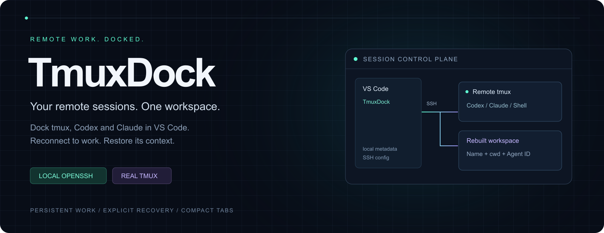
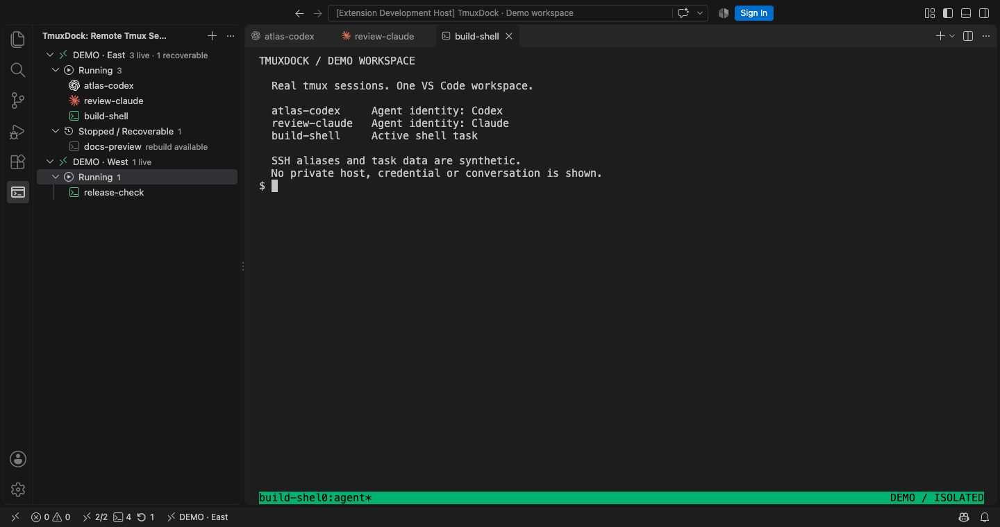
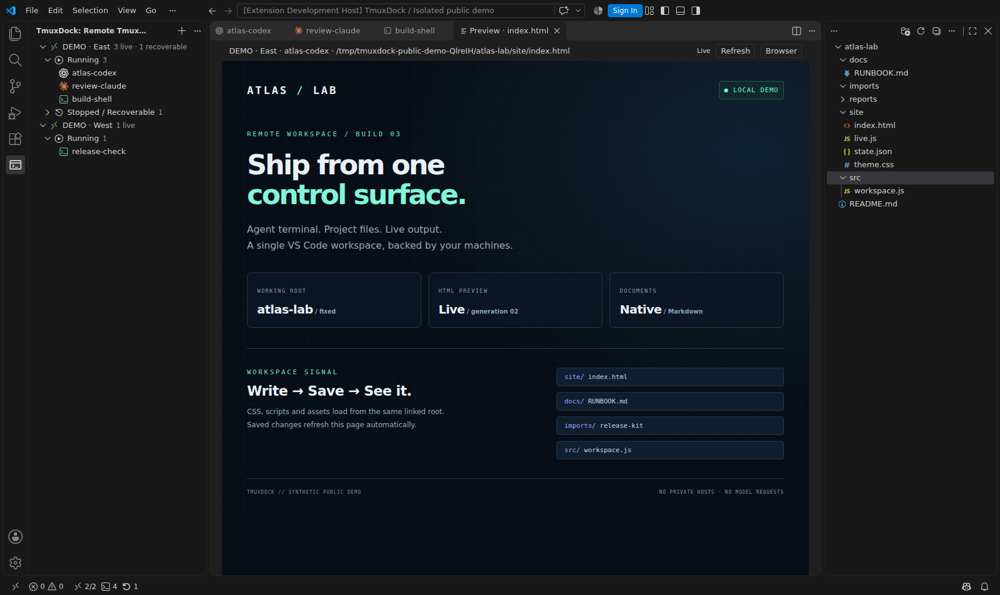
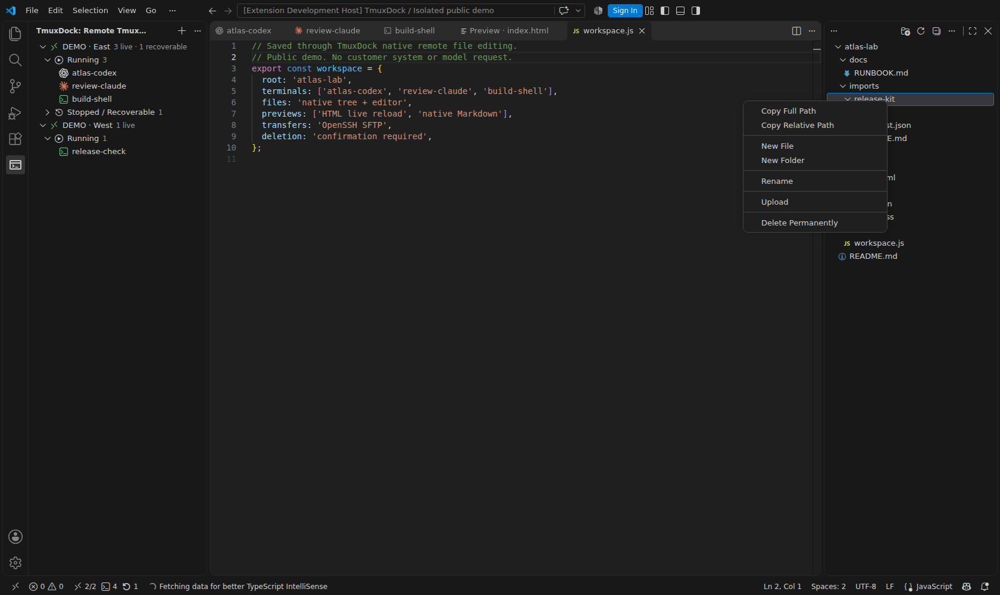
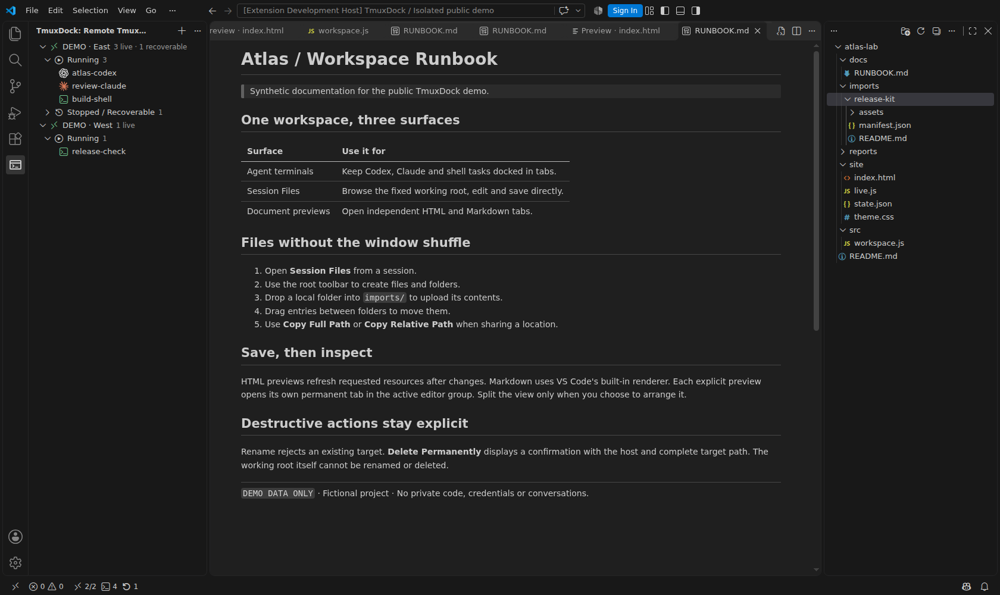
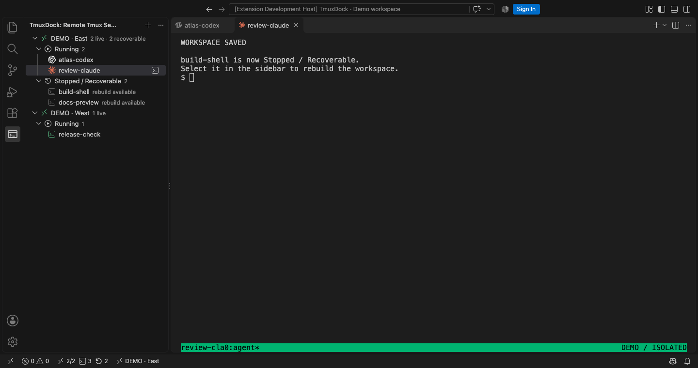
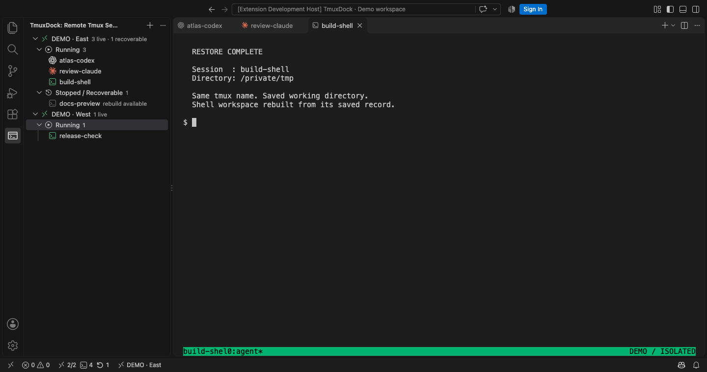

# Your remote work, docked.

**Codex, Claude, project files and live output — together in local VS Code.**

Keep remote tmux tasks within reach across SSH hosts. Open their working directory beside them, edit and transfer files, and preview what your Agent produces without shuffling between windows.

[Source](https://github.com/MingWangSong/remote-agent-sessions) · [All tools](https://github.com/MingWangSong/remote-agent-sessions/blob/v3.3.2/docs/commands.md) · [中文指南](https://github.com/MingWangSong/remote-agent-sessions/blob/v3.3.2/README.zh-CN.md) · [Report an issue](https://github.com/MingWangSong/remote-agent-sessions/issues)

## One sidebar. Your running work.

Connect using your existing SSH aliases. Recognize Codex, Claude and shell tasks by their icons, keep terminal titles compact, and see the active host in the status bar. Running and recoverable sessions stay separate; creation-time sorting and saved drag ordering keep the list stable. Slow operations show progress; an already-open terminal is reused locally.

## One window. The whole task.

Right-click a session → **Session Files**. Its fixed working root appears in VS Code's native secondary sidebar, using your file icon theme. Inspect a report or prototype with **Preview HTML**: CSS, scripts, images and root-relative resources load from the linked directory, then refresh when requested files change.

**Pin File Tree** holds the current root; **Follow Active Session** resumes following session tabs. New sessions keep their initial root through terminal directory changes and recovery. Older sessions pick up their saved or active pane directory; **Link Directory** can change it without enabling recovery.

## From your desktop to the working directory.

- **Upload files or complete folders.** Drop onto the root, any subdirectory or empty tree space. Upload and Download are also available in the menu.
- **Move inside the tree.** Drag files/folders into another directory or back onto the root row. Same-name destinations are protected; uploaded folders never merge into existing folders.
- **Create, edit and save.** New File / New Folder work at the root or a chosen directory. Files open in VS Code's native editor and save directly to the host.
- **Copy a location.** Copy Full Path returns the remote absolute path; Copy Relative Path starts at the session root.
- **Rename or delete deliberately.** Rename refuses collisions. Delete Permanently shows a second confirmation with the host and complete target path. The working root cannot be renamed or deleted.

Transfers reuse OpenSSH, show progress and support cancellation. Regular-file replacements ask first and commit after staging completes.

## Every document gets its own tab.

Use **Preview MD** for VS Code's built-in Markdown rendering. Every HTML or Markdown preview opens a permanent tab, including another preview of the same file. Switching sessions does not replace earlier documents. TmuxDock uses your current editor group and creates no split automatically; arrange tabs yourself when you want a split. Reload Window restores their layout and associations.

## Stop a session. Keep its context.

Before **Stop Session** closes a managed workspace, TmuxDock saves its final directories, windows, panes and known Agent conversation links.

Select its entry under **Stopped / Recoverable** to rebuild the same tmux name in the saved directories. A bound Agent resumes its original conversation ID according to your restore policy.

| Action | Result |
| :--- | :--- |
| Close terminal tab | Detach; remote tmux work continues while its host is available. |
| Stop Session | Save context, then stop tmux and its processes. |
| Restore Session | Rebuild the saved workspace and resume bound Agents when allowed. |
| Remove Record | Remove local recovery metadata; leave running remote processes alone. |

## Your complete toolkit

| Area | Tools |
| :--- | :--- |
| Hosts | Add, edit, remove, refresh, SSH terminal, remote workspace. |
| Sessions | Create, attach, rename, details, notes, persistent ordering and reset. |
| Recovery | Enable recovery, stop, restore, original-history linking, restore commands, remove record. |
| Files | Browse, create, edit/save, rename, full/relative path copy, confirmed permanent delete. |
| Transfers | File/folder upload, file download, drag-to-upload, drag-to-move. |
| Documents | Live HTML, native Markdown, independent tabs, refresh and browser view. |
| Continuity | Follow/pin file root, Reload Window restoration, compact Agent tabs. |
| Backups | Export/import recovery records and import legacy 1.x metadata. |

The [full reference](https://github.com/MingWangSong/remote-agent-sessions/blob/v3.3.2/docs/commands.md) covers all 40 commands and settings.

## Start in three steps

1. Install TmuxDock **locally** and open its activity-bar icon.
2. Select **Add SSH Host** and enter an alias already usable through your SSH config.
3. Click or create a session; open **Session Files** to work with its directory.

**Requirements:** VS Code 1.106+, local OpenSSH and remote tmux 3.2+. Install the relevant Agent CLI remotely for Agent sessions. Files/previews also need Python 3 on a Linux/macOS host; OpenSSH 9+ is recommended. No separately deployed VS Code Server or web service is required for these features.

## Know what is preserved

Recovery rebuilds a workspace, **not process memory**. Original Agent history must still exist on the host. Older unbound records need an explicit link; Codex supports searching original history. Missing history produces an error instead of a guessed replacement conversation. The default `restoreCommands=ask` resumes verified bound Agents directly and asks about custom commands; `never` restores shells only.

Files are scoped to linked roots. Reads and saves support up to 16 MiB per file; HTML resources up to 128 MiB. Child symbolic links are not followed. HTML is a static preview, not a framework dev-server/HMR proxy; scripts require a trusted workspace. Full VS Code application restart depends on VS Code's terminal revival support and can differ from Reload Window.

## Your SSH. Your machines. Your records.

TmuxDock uses local OpenSSH and your SSH config / agent. Recovery metadata stays locally; original CLI transcripts remain on the host. The extension does not store SSH passwords, private keys or full conversation transcripts. It manages Agent CLI sessions in tmux, rather than official chat webviews.

**Image provenance:** the original session/recovery captures are reused. New file-workflow screenshots show the actual extension with synthetic hosts and project files, isolated tmux and real OpenSSH SFTP against a local demo fixture. Agent icons are display-only; no private host, code, credential, conversation or model request is used. [Capture details](https://github.com/MingWangSong/remote-agent-sessions/blob/v3.3.2/docs/showcase/README.md).

---

**中文速览** · 多主机 tmux / Codex / Claude 统一停靠；右侧原生目录树，支持编辑保存、文件夹上传、拖动移动、路径复制、重命名和二次确认的永久删除；HTML 实时预览、Markdown 原生渲染，每次预览保留独立标签。原有会话恢复功能和演示图继续保留。[完整中文说明](https://github.com/MingWangSong/remote-agent-sessions/blob/v3.3.2/README.zh-CN.md)。

Open source · MIT license · Independent project. Agent brand marks identify compatible tools and do not imply endorsement.
