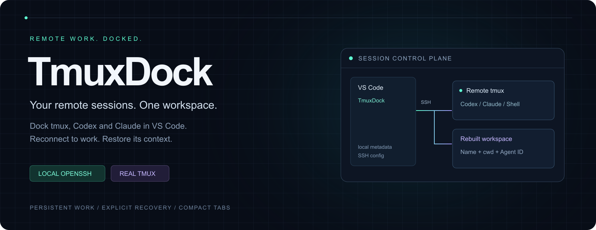
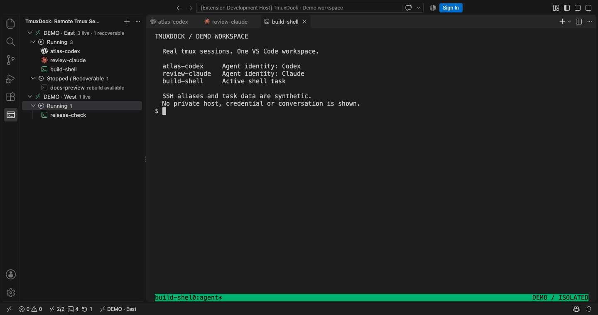
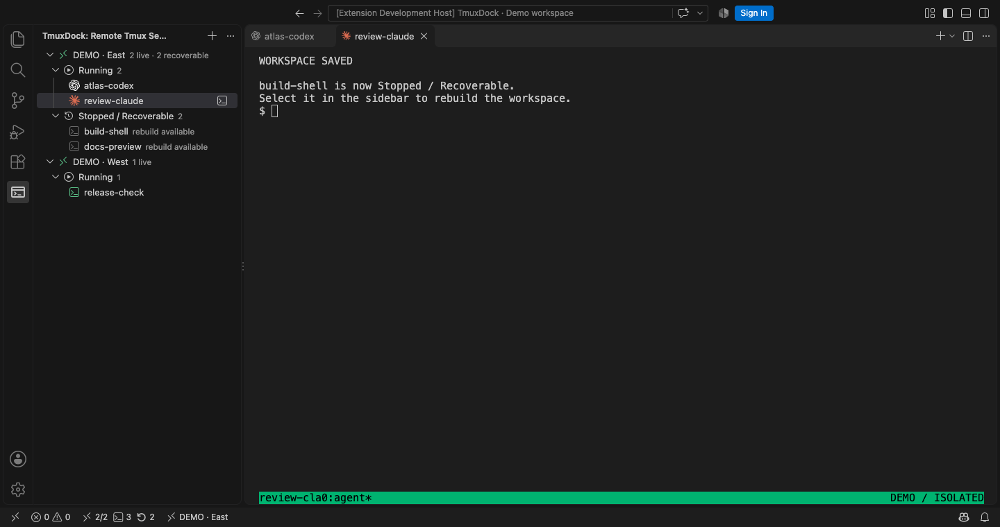
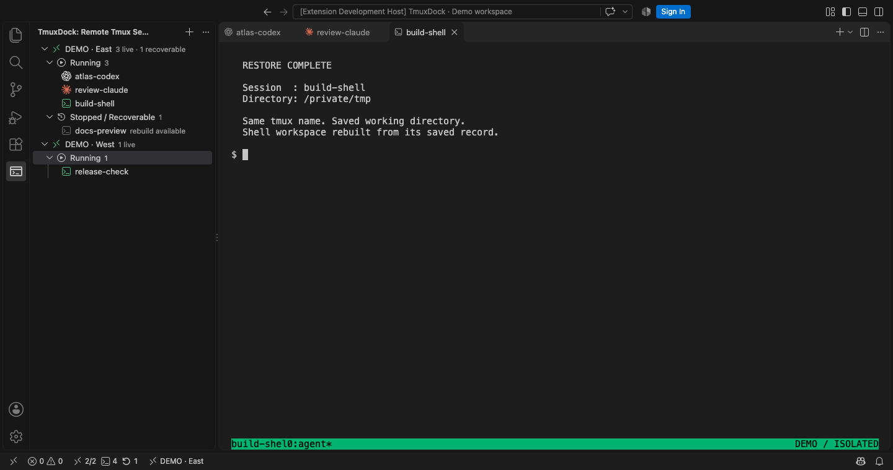

<p align="center"></p>

<p align="center">
  <a href="https://marketplace.visualstudio.com/items?itemName=mingwangsong.remote-agent-sessions"></a>
  <a href="https://github.com/MingWangSong/remote-agent-sessions/actions/workflows/ci.yml"></a>
  <a href="LICENSE"></a>
</p>

<p align="center"><b>A persistent remote workspace for the way you actually build.</b><br>Multi-host tmux. Distinct Agent identities. Recovery with context.</p>
<p align="center"><a href="README.zh-CN.md">简体中文</a> · <a href="https://marketplace.visualstudio.com/items?itemName=mingwangsong.remote-agent-sessions">Install extension</a> · <a href="docs/guide.zh-CN.md">User guide</a> · <a href="CONTRIBUTING.md">Contribute</a></p>

## Keep the work. Lose the terminal sprawl.

TmuxDock brings remote tmux sessions into your **local VS Code**. Browse multiple SSH hosts, open sessions as terminal tabs, and keep Codex, Claude and ordinary shell work recognizable at a glance. Closing a tab disconnects the client; tmux keeps the remote processes running while the host remains available.

When you deliberately stop a managed workspace, TmuxDock saves its final directories, pane layout and known Agent conversation IDs before stopping tmux. Restore builds a new tmux session with the same name and resumes the original bound conversation.



*Real extension UI and real tmux, captured in an isolated demo profile. Host aliases and task names are synthetic. Agent icons use demo configuration; the capture starts no AI model or real conversation.*

## Built around the session lifecycle

| Capability | What it changes |
| :--- | :--- |
| **One dock, multiple hosts** | Discover existing tmux sessions through your local OpenSSH configuration. No per-host extension install required. |
| **Recognizable Agent tabs** | Official Codex and Claude marks, compact session titles, host identity in the status bar. |
| **Stable navigation** | Creation-time ordering, persistent drag ordering, separate Running and Stopped / Recoverable groups. |
| **Visible operations** | Progress and queue feedback for slow SSH requests; already-open terminals are reused locally. |
| **Context-aware recovery** | Rebuild saved windows and panes in their last directories; resume known conversations by exact ID. |
| **Session files beside your Agents** | Native right-sidebar tree, theme-aware file icons, read-only editors and built-in Markdown previews. |
| **Live HTML and file transfers** | Preview HTML with relative resources and automatic reload; explicitly upload or download through OpenSSH. |
| **Reload continuity** | Preserve native terminal tabs and reconnect their host/session associations after Reload Window. |

## Files and previews in the same window

Right-click a session → **Show Session Files**. Its fixed working root appears in the right sidebar using VS Code's native tree and your file icon theme. Switching session tabs follows their directory; **Toggle Follow Session** pins the current tree. The initial root stays fixed even when a terminal changes directory or a stopped session is restored.

Click a file to view it in the native read-only editor. The small context menu offers **Upload Files…**, **Download File…**, **Preview HTML** or **Preview Markdown**, as appropriate. Markdown uses VS Code's built-in preview. HTML previews load CSS, scripts, images and root-relative resources, then reload when requested files change. Preview pinning is independent of tree pinning; Reload Window restores saved file and HTML tabs.

This optional feature requires Python 3 on the Linux/macOS host. Upload/download reuse local OpenSSH's `scp` and existing SSH connection options; use OpenSSH 9+ for SFTP transfers. Uploads ask before replacing a same-name file and stage it before committing. The native editor remains read-only. Older sessions need **Link Working Directory** once; no root is inferred from an old terminal's last directory.

The first version supports static HTML, not a framework dev-server/HMR proxy. It does not follow child symlinks or duplicate Explorer's Git, Timeline or file-management features. Expanded folders and open documents are watched over one persistent SSH file channel; polling pauses when idle and backs off on failures. Disable it with `remoteAgentSessions.sessionFilesEnabled`.

## From stopped to working again

**1 · Save before stopping.** Delete retains a recovery record. A snapshot or conversation verification failure leaves the running session intact.



**2 · Restore the workspace.** Select the saved session to recreate its tmux name, windows, panes and working directories. Bound Codex / Claude sessions use their original conversation IDs; custom commands follow your restore policy.



*The screenshots demonstrate the shell Delete → Restore path. Exact Agent-ID recovery is separately tested with isolated CLI fixtures, without model requests. Recovery rebuilds a workspace; it does not restore process memory or recreate deleted Agent history.*

## Get started

**Requirements:** VS Code 1.106+, local OpenSSH, a reachable SSH host with tmux 3.2+. Install the relevant Codex or Claude CLI on that host for Agent work. Git is optional for repository metadata.

```sh
code --install-extension mingwangsong.remote-agent-sessions
```

1. Open TmuxDock in the activity bar and select **Add SSH Host**.
2. Enter an SSH alias already usable with `ssh your-alias`.
3. Click an existing session, or create a named Codex, Claude or shell session.
4. Close a terminal to detach. Use **Delete Session** to stop and save, **Restore Session** to rebuild, and **Forget Session Record** to permanently remove local recovery metadata.

<details>
<summary><b>Recovery behavior worth knowing</b></summary>

- New built-in Agent sessions are initialized with a known conversation ID and the final session name. Original CLI history must still exist remotely.
- Legacy records without an ID need an explicit original-conversation binding. Codex history can be searched by title, directory and date; a similar name never causes automatic binding.
- A missing directory or conversation causes a clear error. TmuxDock does not guess with `--last` or silently replace a missing conversation.
- `restoreCommands=never` rebuilds shells only. The default `ask` policy resumes verified bound Agents directly and asks about other commands.
- Reload Window relies on VS Code native terminal persistence. Full application restart behavior can vary with VS Code's terminal revival support; reconnect from the sidebar if necessary.

</details>

## Small control plane. Real remote processes.

```text
Local VS Code                         SSH host
┌──────────────────────┐   OpenSSH    ┌──────────────────────┐
│ TmuxDock UI extension│ ───────────► │ tmux                 │
│ host + recovery data │              │ Codex · Claude · sh  │
└──────────────────────┘              └──────────────────────┘
```

TmuxDock runs in the local UI extension host and uses your existing SSH config and agent. It does not store SSH passwords or private keys, bypass host-key checks, or require VS Code Server for session discovery. Recovery metadata stays in local extension storage; CLI transcripts stay with the CLI on the remote host. Export/import supports moving recovery records between installations.

TmuxDock manages Agent **CLI sessions inside tmux**. It does not control official Agent extensions' chat webviews. It does not provide cloud sync or full terminal-output recording. See the [user guide](docs/guide.zh-CN.md) for settings, migration and operational details.

## Develop with confidence

```sh
npm ci
npm run verify
npm run test:integration
npm run test:agent-recovery
npm run test:vscode
npm run package
npm run verify:package
```

Tests use temporary directories and isolated tmux sockets. Agent recovery fixtures make no model requests. CI covers Ubuntu 22.04, Ubuntu 24.04 and macOS; Linux also runs actual VS Code acceptance, native Markdown, HTML rendering, icon and window-reload checks under Xvfb. Local macOS GUI tests are disabled by default so background development does not interrupt your desktop. [Validation evidence](docs/evidence/README.md) · [Contributing](CONTRIBUTING.md) · [Changelog](CHANGELOG.md)

[Report a bug or propose an improvement](https://github.com/MingWangSong/remote-agent-sessions/issues). Include the extension version, local OS, remote tmux version and a sanitized reproduction. Never include credentials or private conversation transcripts.

MIT licensed. Codex / OpenAI and Claude marks belong to their respective owners; their use identifies compatible CLI sessions and does not imply endorsement.
