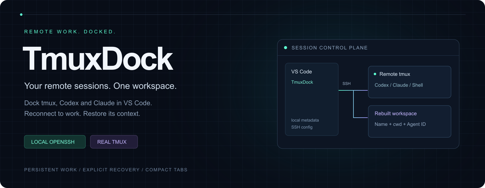
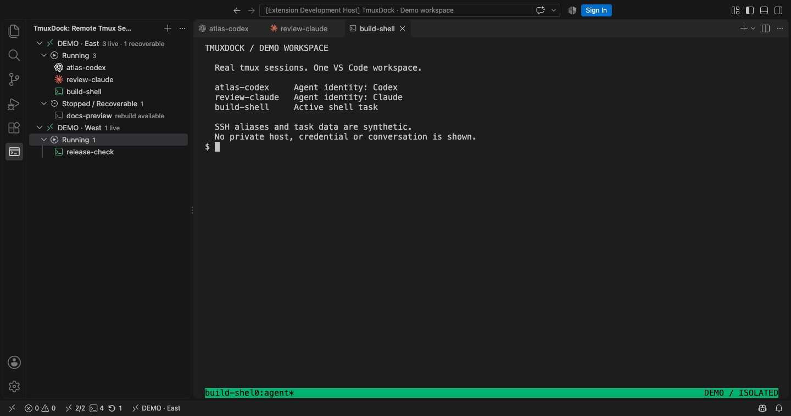
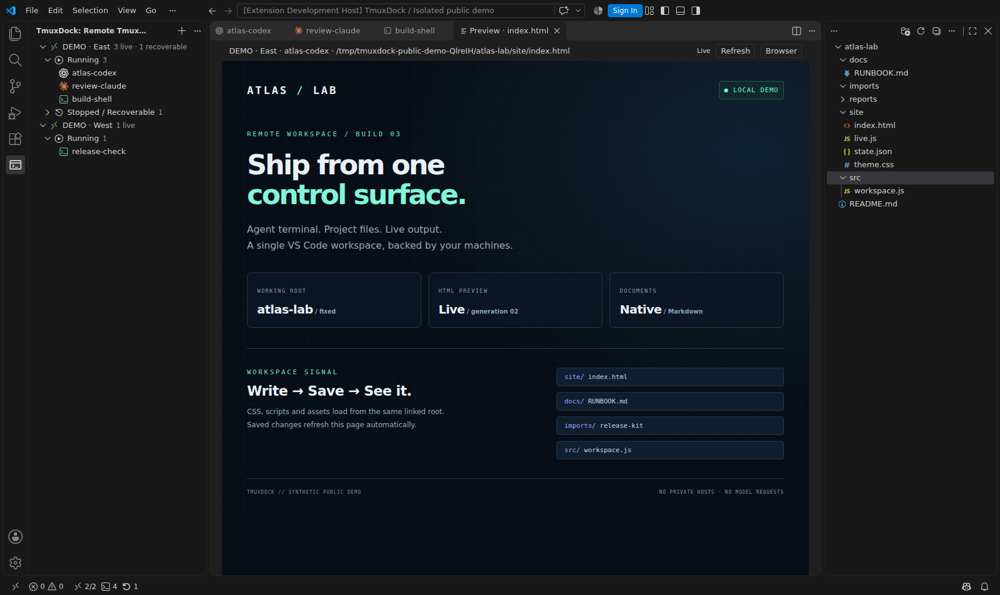
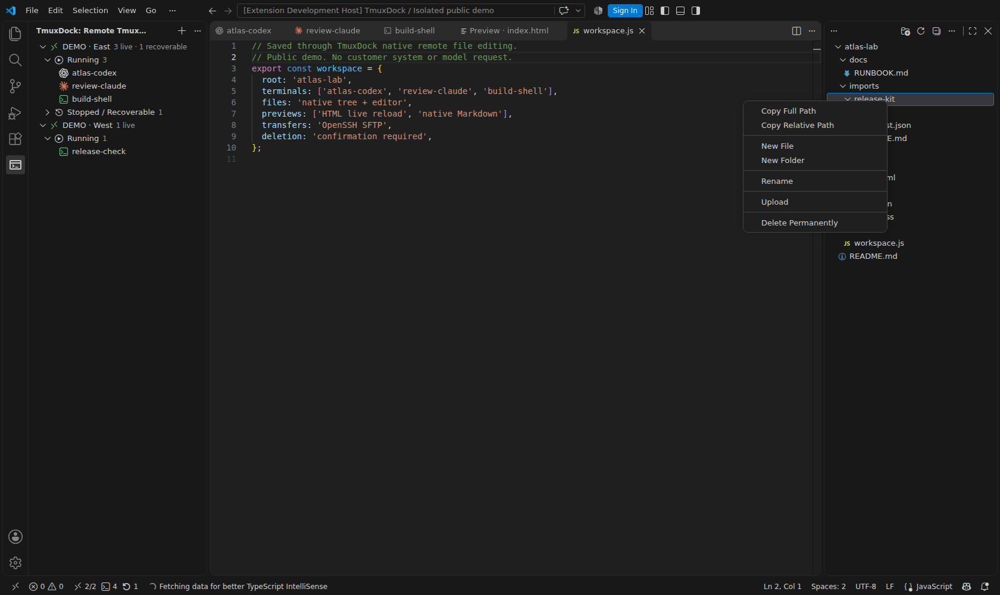
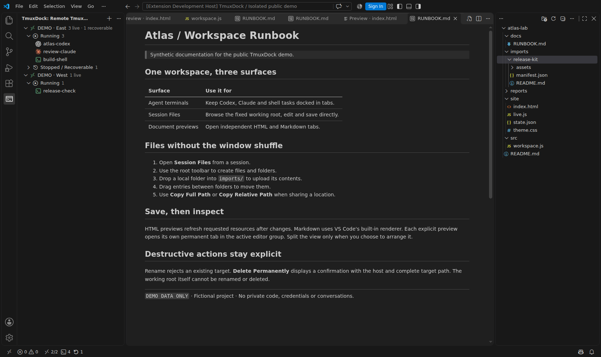
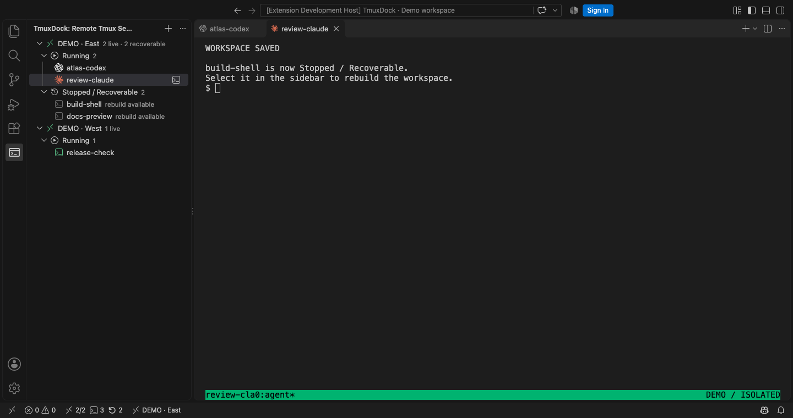
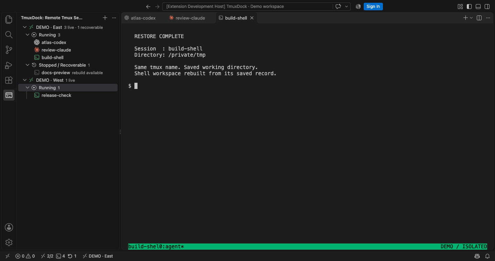

# 让远程工作，始终停靠在手边。

**把多台主机上的 tmux、Codex 和 Claude，收进一个本地 VS Code 工作区。**

[安装插件](https://marketplace.visualstudio.com/items?itemName=mingwangsong.remote-agent-sessions) · [English](README.md) · [完整指南](docs/guide.zh-CN.md) · [全部工具](docs/commands.md) · [更新记录](CHANGELOG.md)

## 不止连接，更能接着工作

| 能力 | 使用体验 |
| --- | --- |
| 多主机停靠 | 用现有 SSH 配置发现、创建和连接 tmux，无需逐台安装插件。 |
| Agent 一眼识别 | Codex、Claude 使用官方标识，普通 Shell 使用终端图标；标签只保留简短会话名。 |
| 列表不再跳动 | 按创建时间排列，也可拖拽保存顺序；运行中与停止记录分开显示。 |
| 慢网络有反馈 | 操作显示进度和排队状态；已有标签本地直接复用。 |
| 删除后可恢复 | 先保存最后目录、布局和原对话 ID，再停止 tmux；恢复时重建同名会话并续接原对话。 |
| 右侧原生目录树 | 跟随 session 的固定工作目录，使用当前文件图标主题和原生编辑器。 |
| 文件与实时预览 | 上传、下载文件；HTML 资源变化自动刷新；Markdown 复用 VS Code 自带预览。 |
| 重载保留标签 | 使用 VS Code 原生终端持久化，恢复标签及主机关联。 |

## 文件与实时输出，同窗完成

### 看结果，不必再开一个远程窗口

右键会话 → **Session Files**，在右侧原生目录树查看固定工作根目录，沿用你的文件图标主题。**Preview HTML** 渲染同目录的 CSS、JS、图片和根相对路径资源，已请求资源发生变化后自动刷新。图中页面的 generation 02 来自一次实际保存后的自动更新。

新会话保留初始化目录，终端 `cd` 或 Stop / Restore 不改变它；旧会话首次查看时固定已保存或当前活动分屏目录，也可用 **Link Directory** 修改，无需先启用恢复。**Pin File Tree** 固定当前树，**Follow Active Session** 恢复跟随会话标签。

### 文件夹直接上传，文件原地编辑

- **新建与保存：**标题栏 New File / New Folder 作用于工作根目录，目录右键作用于该目录。单击文件进入 VS Code 原生编辑器，保存直接写回主机。
- **传输与移动：**从桌面拖入文件或完整文件夹，可上传到根目录、子目录或空白区域；也可使用 Upload / Download。目录树内拖动用于移动，拖回根目录行即可移回。上传有进度和取消入口。
- **路径与维护：**Copy Full Path 复制远端绝对路径；Copy Relative Path 相对当前 session 根目录，根目录本身为 `.`。Rename 拒绝同名目标；Delete Permanently 必须二次确认，提示主机、完整路径与文件夹全部内容，工作根目录禁止重命名和删除。

文件夹上传不合并已有目录，普通文件覆盖先确认。传输完成后才提交目标；新建和保存复用持久文件通道。

### 文档标签各自保留，布局由你决定

**Preview MD** 复用 VS Code 自带 Markdown 渲染。HTML / Markdown 每次预览都新建永久标签，同一文件也可多次打开；切换 session 不替换旧预览。插件使用当前编辑器分组，不自动创建分屏；需要时由你手动排列。重命名或移动会更新所属预览，Reload Window 恢复布局与关联。

远端文件功能需要 Linux/macOS 的 Python 3，本机需 OpenSSH，推荐 9+。原生读取/保存限制 16 MiB，HTML 单资源限制 128 MiB；不跟随子级符号链接，不代理开发服务器/HMR。HTML 脚本要求可信工作区，本地预览服务只监听回环地址。可通过 `remoteAgentSessions.sessionFilesEnabled=false` 停用。

*新增图片来自隔离配置和虚构项目，实际运行 tmux、文件通道与 OpenSSH SFTP；Agent 图标仅用于类型展示，没有模型请求、真实服务器、私有代码或对话。[截图来源](docs/showcase/README.md)。原有会话恢复图片继续复用。*

## 全部工具入口

[完整工具索引](docs/commands.md) 对照当前插件清单，列出全部 **40 个命令**、入口和作用，包含 8 项机器级配置：

| 模块 | 工具 |
| --- | --- |
| 主机 | 添加、编辑、移除、刷新、SSH 终端、远程工作区。 |
| 会话 | 创建、连接与标签复用、重命名、详情、备注、顺序重置。 |
| 恢复 | 启用恢复、停止、恢复、关联原 Agent 历史、恢复命令、移除记录。 |
| 文件 | 目录树、新建文件/目录、编辑保存、完整/相对路径、重命名、二次确认的永久删除。 |
| 传输与预览 | 文件/文件夹上传、文件下载、拖动移动、实时 HTML、原生 Markdown、刷新、浏览器打开。 |
| 连续工作 | 目录跟随/固定、独立文档标签、Reload Window 后恢复关联。 |
| 备份迁移 | 导出/导入恢复记录、导入 1.x 元数据。 |

## 从停止，到继续

**Stop Session** 保存后停止会话并保留恢复记录。打开 **Stopped / Recoverable**，点击对应会话，即可按快照重建。

恢复工作区不等于恢复进程内存。原 Agent 历史需仍保存在远端，旧记录需显式绑定原对话。截图使用隔离配置和合成任务数据，展示真实插件的 Shell 恢复；Agent 图标来自演示配置，没有运行模型或编造 AI 对话。

## 三步开始

1. 本地安装 TmuxDock；本机需 OpenSSH，远端需 tmux 3.2+，VS Code 需 1.106+。
2. 在活动栏打开 TmuxDock，点击 **Add SSH Host**，输入已能通过 SSH 连接的别名。
3. 点击现有会话，或创建 Codex、Claude、Shell 会话。Agent CLI 需安装在远端。

关闭终端标签只断开连接，远端 tmux 继续运行；**Stop Session** 保存后停止；**Restore** 重建；**Remove Record** 永久移除本地记录、不停止远端进程。

## 本地控制，远端执行

插件运行在本地 VS Code，通过本机 OpenSSH 和 ssh-agent 连接远端。会话恢复元数据保存在本地，Agent 历史仍由远端 CLI 管理。不保存 SSH 密码、私钥或对话全文。支持备份导入导出，不提供云同步，也不控制官方 Agent 插件的聊天 Webview。

[配置与迁移](docs/guide.zh-CN.md) · [架构和开发](README.md#small-control-plane-real-remote-processes) · [测试证据](docs/evidence/README.md) · [参与贡献](CONTRIBUTING.md)

MIT 开源。Codex / OpenAI、Claude 标识归各自所有者所有；展示兼容工具不代表官方背书。
