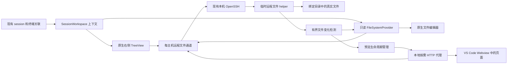

# TmuxDock 单窗口远程工作区设计与实施规划

日期：2026 年 11 月 6 日。基线：TmuxDock 2.5.1，源码提交 `def2290`。阶段：设计规划。

建议在现有本地多主机控制器上增加 session 工作区层：左侧管理 session，右侧显示所选 session 的远程文件树，中间保留 Agent 终端、原生文件编辑器和 HTML 预览。跨服务器切换不替换 VS Code 工作区，不要求每台机器安装 VS Code Server。

首个可用版本应同时覆盖跨主机目录跟随、文件实时查看、HTML 相对资源和自动刷新。远程文件写入另行实现；它不应成为解决当前查看痛点的前置条件。

## 用户体验与交付边界

| 需求 | 首次完整交付的行为 |
| --- | --- |
| 固定目录 | 新建 session 时固定其工作根目录，终端执行 cd 不改变右侧根目录。 |
| 单窗口 | 同一窗口保留原会话标签、右侧目录树、文件和预览，不因文件浏览调用 openFolder。 |
| 跨主机 | 切换不同主机的 session，目录树自动切换到对应主机与根目录。 |
| 查看文件 | 单击使用原生预览标签，双击固定标签；首版为只读查看。 |
| 实时更新 | Agent 在远端保存、创建、删除或原子替换文件后，已打开文件和相关目录更新。 |
| HTML | 支持 HTML、CSS、JS、图片、模块和工作根目录内的相对请求；修改后自动刷新。 |
| 恢复 | Delete 与 Restore 保留工作根目录，同时继续使用最后 pane 目录和原 Agent 对话 ID 恢复。 |
| 布局保留 | 窗口重载后恢复工作区关联和用户布局，重连按需进行，不启动新 Agent。 |

首次交付不包含远程编辑写回、Git 完整集成、全仓库搜索、语言服务器、项目构建或任意后端框架启动。这些能力不能因为文件显示在原生编辑器中就被默认承诺。

“目录固定”指浏览范围和 session 归属固定，并不限制 Agent 或终端的 cd 行为。更换工作根目录需要明确的“重新关联工作目录”操作；它不自动移动文件或修改运行中的 Agent 工作目录。

## 原生能力调研结论

| 路线 | 能复用的能力 | 对完整需求的适用性 |
| --- | --- | --- |
| Remote-SSH 加原生 Explorer 和 Live Preview | 远程文件、编辑器、预览 | 同主机可作为现成操作方案，但不能据此实现多个 SSH 主机的 session 无缝自动跟随。保留为可选入口。 |
| SSHFS 或本地同步目录 | 本地文件工具 | 增加挂载或同步依赖；同步副本引入延迟和覆盖风险，不作为默认方案。 |
| TreeView 加 FileSystemProvider | 原生树控件、文本编辑器、文件变更事件 | 推荐作为核心；文件资源按 URI 访问，不必替换用户工作区。 |
| 只读 TextDocumentContentProvider | 原生只读文本 | 适合简单文本展示，文件类型、目录和二进制支持有限，不作为主文件模型。 |
| 直接把远程文件交给内置浏览器 | 浏览器渲染 | 不成立：内置浏览器的直接打开 HTML 文件功能限本地 file URI，远程和虚拟资源不适用。 |
| 将自定义文件系统交给 Live Preview | 已有静态预览和刷新 | 不作为跨主机必需依赖：其 manifest 声明 virtualWorkspaces 为 false。 |
| 本地按需 HTTP 代理加受控预览容器 | Chromium 渲染、真实 HTTP 资源加载 | 推荐作为静态 HTML 预览核心；仍在 VS Code 窗口内显示。 |

VS Code 1.106 提供正式的 `secondarySidebar` 视图容器贡献点。推荐新功能版本最低要求 1.106，旧 VS Code 继续使用现有兼容版本；不要在声明支持 1.90 的包中无条件使用新容器。当前本机 1.143.1 已具备该能力。[官方发布说明](https://code.visualstudio.com/updates/v1_106#_view-containers-in-secondary-side-bar)

文件访问复用官方 FileSystemProvider 接口，提供只读能力及变更事件。右侧树采用原生 TreeView，但不冒充拥有 Git、搜索和扩展兼容性的完整 Explorer。[文件系统接口](https://code.visualstudio.com/api/extension-guides/virtual-documents#file-system-api)、[官方示例](https://github.com/microsoft/vscode-extension-samples/tree/main/fsprovider-sample)

内置浏览器支持 HTTP 页面；直接打开远程或虚拟 HTML 文件存在上述限制。其远程代理还会影响 localhost 的实际归属，因此本地预览地址在 Remote-SSH 窗口中需要专项验证。[内置浏览器说明](https://code.visualstudio.com/docs/debugtest/integrated-browser)

Live Preview 可以处理静态站点并自动刷新，但不能把它对普通工作区的能力直接推广到自定义远程资源。[官方说明](https://github.com/microsoft/vscode-livepreview#readme)、[manifest](https://github.com/microsoft/vscode-livepreview/blob/main/package.json)

## 界面与联动规则

```text
左侧 TmuxDock             中间编辑区                         右侧 Session Files
主机与 session           Agent 终端 | 文件源码或 HTML        主机 · session
运行和停止分组           可并排、可固定                      固定工作根目录
                                                         文件树与刷新状态
                                                         跟随或固定按钮
```

右侧标题始终显示主机、session、工作根目录和连接状态，避免同名 session 或同名文件混淆。默认跟随当前 TmuxDock 标签；点击其文件或预览后保留对应归属，不能因焦点离开终端而清空目录树。

| 操作 | 联动规则 |
| --- | --- |
| 切换 Agent 标签 | 立即切换右侧上下文；先显示已缓存目录与更新时间，再异步更新，不抢编辑焦点。 |
| 点击目录 | 按需展开一级，目录优先排序，保留各 session 的展开状态。 |
| 点击文件 | 在原生编辑器打开；标签悬停和目录树说明包含主机与完整路径。 |
| 点击 HTML | 默认先看源码；显式点击预览按钮或右键 Preview HTML 才执行页面脚本。 |
| 切换到另一个 session | 若它曾打开预览且预览区域已启用，恢复其上次预览；否则显示未选择 HTML 的空态，不自动挑选和执行文件。 |
| 固定目录或预览 | 固定的区域不随 session 切换，明确显示所固定的主机与 session，可独立解除。 |
| 点击无关联的普通文件 | 保留最近的 session 上下文，显示最近选择；不反向猜测文件所属主机。 |
| 主机断线 | 保留已显示内容并标记离线或陈旧；禁止把另一个主机的缓存当作当前内容。 |
| session 已停止 | 只要主机可达，仍可查看其工作目录，不必先恢复 Agent。 |

自动刷新只更新内容和状态，不改变当前选择、文件树顺序和编辑器焦点。右侧栏隐藏后不强行弹出；提供显式“显示 Session Files”命令，尊重用户移动视图后的布局。

## 推荐架构



现有 tmux 操作队列、SSH 控制器、对话初始化和恢复代码继续负责其原有生命周期。新增文件通道独立排队，不把读目录、读取图片和变化检测放进 tmux 操作串行队列。

默认面向本地 VS Code 窗口提供完整跨主机能力；同时在 Remote-SSH 窗口验证文件树和预览共存。后者不能依赖“所有 localhost 都属于本机”的假设，也不能把其他主机的 tmux 终端错误地转成从当前服务器发起 SSH。现有同主机 attach 分支保留，其他主机场景纳入兼容门槛。

### 远程文件通道

推荐复用现有 OpenSSH 配置、ssh-agent 和连接复用，通过独立 SSH channel 运行短小的 Python 3 stdio helper。它按需启动，关闭通道时退出；无需常驻服务、远端 HTTP 端口或 sudo，也不向用户目录写入安装文件。

选择这一方式的原因是，逐文件执行 ssh cat 或 find 会让每个资源承担一次往返和子进程开销；用固定分隔符解析 ls 输出也无法可靠处理特殊文件名。现有 readText 还将 stdout 当作文本并有整块缓冲上限，不能直接充当通用文件访问层。

helper 提供握手、批量 stat、分页目录枚举、范围读取和变化通知。协议使用有长度边界的帧与请求 ID，数据与诊断分离；路径通过协议传递，不拼接到 shell 命令。支持二进制分块、背压、超时、取消和断线后重新握手。先确定协议版本、最大帧和错误码；不能用每次读取新建 SSH 进程来冒充持续通道。

Python 3 是新增文件功能的可选能力依赖，首次连接时检测；缺失时给出明确原因，现有 tmux 管理继续可用。SFTP 作为不依赖 Python 的后续替代通道，需要单独证明能保留现有 OpenSSH 配置和认证体验，不临时引入会绕过这些配置的 SSH 库。

## 数据模型与兼容迁移

| 数据 | 用途 | 更新时机 |
| --- | --- | --- |
| workspaceRoot | 创建时选择的固定浏览根目录 | 新建时保存；显式重新关联时修改。 |
| rootSource | created、explicit 或 legacyCandidate | 表明根目录来源，避免误认旧记录。 |
| lastCwd 与兼容字段 cwd | 当前主要 pane 最后目录 | 继续在快照和删除前捕获。 |
| windows 中各 pane.cwd | 每个 pane 的恢复目录 | 沿用现有恢复快照。 |
| agent.sessionId | 原 Agent 对话身份 | 沿用现有初始化、绑定和校验。 |
| 本机视图状态 | 跟随、固定、展开项和最近预览 | 按窗口或工作区保存，不写入远端。 |

固定根目录和最后工作目录必须分开。当前 stopWithRecovery 会更新 record.cwd，不能直接把 cwd 作为永不变化的浏览根目录。Restore 仍优先使用每个 pane 的最后目录，而不是一律回到 workspaceRoot。

新字段先采用可选扩展，备份导入导出保留字段。旧记录的 cwd 可能已被删除快照改写，只能作为候选目录展示，不能声称已找回初始化目录。已存在但无记录的 tmux session 首次使用文件功能时显式选择并保存根目录；仅点击查看不应顺带停止、重命名或绑定 Agent。

文件 URI 按主机 ID 和远端绝对路径确定，例如 `tmuxdock-remote://host-id/workspace/project/report.html`，使用 Uri.from 构建。不同主机永不复用同一文档；同一主机、同一文件尽量共享 URI。URI 不随 session 改名而改变。访问权限取决于已关联根目录，而不是仅凭 URI 中的路径。多个 session 共享同一文件时，右侧归属优先当前相关 session，不任意跳转。

## 实时文件更新与性能

第一版以远端有界轮询为基线：同一主机的 helper 聚合检测当前展开目录、已打开文件和预览依赖；只把变化推送回本机。后续可加入系统原生文件事件，不能把 inotify 或额外 pip 包作为首版前提。

建议初始参数如下，属于待压测调优的目标值，不是当前性能承诺：

| 项目 | 初始策略 |
| --- | --- |
| session 切换 | 先切换界面上下文，目标 100 ms 内展示缓存与明确状态，不等待 SSH。 |
| 变化检测 | 有可见内容时约 1 秒一批，变化合并约 300 ms；目标常见文件更新 2 秒内可见。 |
| 并发读取 | 每主机先限制 4 路，元数据与大文件分离，优先目录和当前文件。 |
| 目录枚举 | 右侧树按层懒加载，大目录分页；默认不递归扫描 .git、node_modules、构建缓存。 |
| 文本 | 先以 2 MiB 自动打开阈值做体验验证，更大文件提示或按需读取。 |
| 预览资源 | 分块读取和缓存；保留对较大图片及 Range 请求的能力，设置总内存预算。 |
| 无人查看 | 暂停无订阅的监控；后台预览降频，最后使用者关闭后释放通道。 |
| 网络异常 | 有限重试与退避，显示缓存时间，不无限堆积请求。 |

树视图的“加载更多”由自己的目录接口实现。FileSystemProvider.readDirectory 没有分页返回契约，不能把第一页伪装成完整目录；对该接口应完整返回可接受规模的目录，超限时明确报错。首版不把自定义目录强行加入原生工作区来触发全仓库枚举。

变更识别结合纳秒时间、大小和文件身份，覆盖 Agent 常用的临时文件重命名替换。必要时为正在查看的小文件计算内容指纹；不对全仓库逐文件求哈希。纳秒时间在协议中用字符串或安全结构表示，避免 JavaScript 整数精度丢失。

快速切换 A 到 B 时，用上下文代数和请求 ID 丢弃 A 的迟到结果。对同一目录的重复请求合并。查看文件和预览不能因为远端文件通道缓慢而阻塞已有终端的本地切换。

## HTML 预览设计

### 静态文档默认路径

文件通过远程通道按需读取，本机 HTTP 代理按工作根目录提供页面及资源。它不镜像整个目录，不回写 HTML，也不启动远端 Web 服务。工作根目录映射为 URL 根目录，确保 `./style.css`、`../assets/logo.png`、`/assets/main.js`、CSS 中的 url、JS 模块及目录内 fetch 有一致语义；越过已绑定根目录的资源不被自动开放。

每个主机与工作根目录使用独立的预览 origin。优先验证随机子域的 localhost 加随机端口，避免不同项目的 Cookie、缓存和 localStorage 混用。入口凭证、Host 与 Origin 校验、资源 URL 兼容必须一起验证，不能采用会让根相对路径失效的简单 token 路径拼接方案。进程重启后凭证与端口重新建立，不保存过期入口。根目录被显式重新关联时生成新的预览实例，旧 URL 不可被静默指向另一个目录。

推荐默认容器为原生 WebviewPanel 加最小工具栏，页面在独立 HTTP iframe 中运行。插件控制外层的主机、session、路径、跟随和刷新；HTML 仍由 VS Code 提供的浏览器运行环境渲染。这样可在远端文件变化时刷新指定预览，不依赖尚未验证的内置浏览器标签控制接口，也不要求向用户页面注入脚本。

预览变化事件由扩展消息传给外层，再重载对应 iframe。HTML、CSS、JS 和已请求的图片变化均可触发。尊重原页面 CSP，不删除安全头或强行放宽脚本策略。首版提供自动整页刷新，不能宣传为框架 HMR；刷新可能重置页面表单状态，滚动位置在跨源或严格 CSP 页面中也不能保证保留。

### 内置浏览器与现有服务

提供“在 VS Code 内置浏览器打开”入口，便于使用浏览器原生调试能力。是否可稳定按指定标签刷新、保持分组和恢复 URL，由可行性验证决定；未证明前不把它作为自动跟随与实时刷新的唯一实现。

用户已有 Vite、文档站或其他开发服务器时，支持显式关联服务地址，保留其 HTTP、API、WebSocket 和 HMR 行为，按需通过 SSH 本地转发访问。此模式不假装静态代理能运行服务端代码，也不默认转发任意网站。已有服务禁止 iframe 嵌入时，使用内置浏览器打开。

### 资源与刷新范围

代理记录实际请求的 HTML、CSS、JS、图片及数据文件，并对相关父目录新增资源进行有界检测。首次未被请求、也不在监控目录内的文件不承诺触发刷新；提供手动刷新及刷新范围设置。原子替换、资源删除、短暂不完整写入需去抖和重试，避免连续闪烁或显示半写入页面。

## 边界与故障处理

- 访问范围限定为用户关联的目录。路径标准化、解码、realpath 与文件描述符层面的校验要配套，防止目录穿越、相似前缀和符号链接替换绕过。根外链接显示清晰状态，不静默开放服务器其他目录。
- 预览仅绑定本机回环地址，关闭目录列表；不默认公开 .env、私钥或 .git 等敏感路径。HTTP 代理不提供写文件或执行命令接口。
- 页面脚本与扩展权限隔离。iframe 不获得 VS Code API、SSH 凭据或任意命令执行通道；外层消息验证来源和消息结构。遵守工作区信任状态，不因打开树视图就执行 HTML。
- 中文、空格、引号、井号、问号、百分号和换行文件名通过结构化协议与 URI 编码处理。NUL 拒绝；无法表示的非 UTF 编码名称明确标记，不映射到另一个名称。
- 断线不切换到本机或其他主机数据。恢复连接后重新确认主机、根目录和监控版本，再更新缓存。
- 关闭预览或重载只回收由插件创建并登记的 helper、监听和连接；不杀用户 tmux、Agent 或既有开发服务器。不按端口号直接杀进程。
- 删除 session 保留工作区记录；Forget 最终移除关联时处理打开文档的只读陈旧状态和订阅释放。多个 session 共用根目录时按引用计数管理。
- 新增能力可独立关闭。关闭后停止文件订阅和预览代理，原有 tmux 生命周期不依赖它成功。

## 现有代码复用与新增模块

| 位置 | 规划改动 |
| --- | --- |
| model.js、store.js、backup.js | 增加和校验工作根目录字段，保持旧记录可读和备份兼容。 |
| sessionManager.js | 创建时保存根目录；快照更新最后目录，不改根目录；Delete 和 Restore 保留两类语义。 |
| extension.js、terminalPersistence.js | 复用实际终端身份关联，向独立上下文服务通知选择变化，保留现有状态栏行为。 |
| ssh.js | 复用已有认证和复用参数；新增二进制安全的文件通道适配，不改变 tmux run 调用约定。 |
| package.json | 增加右侧视图、文件与预览命令、能力配置；按已验证版本确定引擎下限。 |
| sessionWorkspace.js | 主机、session、根目录、跟随或固定、选择代数和视图状态。 |
| remoteFiles.js、remoteFileChannel.js | 目录与文件服务、协议、缓存、取消、监控和通道生命周期。 |
| remoteFileSystem.js、workspaceTree.js | 原生 URI 文件系统和右侧树。 |
| previewService.js、previewPanel.js | HTTP 代理、origin 隔离、预览归属、iframe 刷新和已有服务适配。 |

文件名为建议划分，最终以原型接口为准。模块之间通过明确事件通信，避免把全部逻辑继续塞进 extension.js。

## 实施阶段与放行条件

| 阶段 | 工作内容 | 放行条件 |
| --- | --- | --- |
| P0 可行性验证 | 自定义文件系统、右侧容器、HTTP 页面、预览隔离、远程通道最小样例。 | 确认稳定 API、版本下限、所需远端能力、自动刷新路径；解决本节后列出的关键验证项。 |
| P1 数据与文件工作区 | 固定根目录、旧记录显式关联、session 上下文、跨主机只读树和文件打开。 | 同名主机路径不串线，切换不重载窗口，Delete 与 Restore 不改变根目录。 |
| P2 实时更新 | 可见范围监控、文件事件、缓存、断线重连、迟到结果丢弃。 | 覆盖新建、删除、替换、慢网络和快速切换，终端操作不受文件请求排队影响。 |
| P3 HTML 完整链路 | 资源代理、受控预览、自动刷新、跨 session 归属和现有服务入口。 | HTML、CSS、JS、图片、模块、根相对路径、CSP 和多 origin 场景通过。 |
| P4 回归与交付 | 隔离 VS Code 验收、真实 SSH 小目录验收、资源回收、文档与脱敏截图。 | 以下验收矩阵及原有回归通过，才构建和发布新版。 |

P1 或 P2 只能作为内部预览，不能宣称已经解决用户的 HTML 实时预览需求。先完成一个 session 的“选择根目录 → 查看文件 → Agent 保存 → HTML 自动刷新”完整纵向样例，再扩展并发和缓存，避免只有侧栏而没有可用体验。

P0 尚需专项验证的项目：

1. 原生内置浏览器的指定标签刷新、分组与恢复能力；受控 iframe 预览在严格 CSP 下的刷新和资源隔离。
2. Remote-SSH 窗口开启远程浏览器代理时，本地预览 origin 的正确路由，以及不同主机 tmux 终端的执行位置。
3. stdio helper 的帧拆分、二进制读取、取消、背压、网络中断和无 Python 环境的明确降级。
4. 纳秒时间或内容指纹监控下的 Agent 原子替换，以及根目录重命名和符号链接竞态处理。
5. 多个 origin 的凭证、Cookie、存储和路径边界；关闭、崩溃、重载后由插件创建的资源回收。

## 验收矩阵

| 场景 | 通过标准 |
| --- | --- |
| 同主机两个 session 不同目录 | 文件树、文件来源、预览均与所选 session 一致，切换后保留各自展开状态。 |
| 两主机同名 session 和同路径文件 | URI、缓存、变化事件、HTTP origin 和标签归属完全分离。 |
| 终端 cd 后 Delete 和 Restore | 浏览根目录保持初始化值；tmux 每个 pane 仍恢复最后目录；Agent ID 不变。 |
| 两 session 共用一个目录 | 不重复监听同一目录；关闭一个不打断另一个；同一文件尽量复用原生文档。 |
| Agent 改写文本和创建文件 | 文档与目录更新，预览自动刷新，不抢焦点、不重复打开标签。 |
| HTML 引用资源 | 相对 CSS、根相对 JS、图片、模块、JSON fetch 和锚点正确；浏览不会回写源文件。 |
| 严格 CSP 文档 | 不删除 CSP；支持的静态页面可渲染和刷新，限制有明确表现，不静默失效。 |
| 慢网络与切换竞态 | A 的旧响应不能覆盖 B；显示加载或陈旧状态；已有终端仍可立即本地切换。 |
| 主机断线和重连 | 已显示内容保留并标记，重连校验后恢复；不回落到另一主机或本机数据。 |
| 根目录缺失或无权限 | 文件功能明确提示，原有 session 管理保持可用。 |
| 不可信路径与页面 | 遍历、编码绕过、根外链接、消息伪造和跨项目读取测试不越权。 |
| 多窗口与两次 Reload Window | 保留原标签恢复和原 Agent 进程；视图关联重建，不重复启动 helper 或预览服务。 |
| 资源与平台 | Linux 远端优先；macOS 和 Windows 本机路径、SSH 行为分别验证；大目录、长文件、二进制和分页有界。 |

现有回归至少包括 npm run verify、test:integration、test:agent-recovery、test:vscode、test:reload、test:icons、package 和 verify:package。新增测试分别覆盖上下文状态、文件通道、变化检测、真实 HTTP 页面与 SSH 验收；所有破坏性测试使用临时目录和随机 tmux socket，不动用户现有任务。

## 已完成的可行性检查

2026 年 11 月 6 日，本机 VS Code 1.143.1 的隔离 profile 验证通过六项：

1. 自定义文件系统 URI 可在原生文本编辑器打开，两个主机的同路径文件不混用。
2. 打开文件不需要替换或新增工作区文件夹。
3. FileSystemProvider 的变化事件可以更新已经打开的原生文本文档。
4. secondarySidebar 容器和原生 TreeView 可以激活。
5. 内置浏览器经 HTTP 加载嵌套 HTML，并正确请求根相对 CSS、JS 模块和 fetch 数据。
6. 随机子域的 localhost origin 在该浏览器中可访问，无需修改系统 DNS。

这些检查使用内存文件与本地测试 HTTP 服务，验证 API 可行性，不构成完整 SSH 文件服务、预览安全或自动刷新实现的验收。交付文件另附 `tmuxdock-workspace-api-probe.json`；仓库内证据位于同目录的 `workspace-api-probe.json`。

对常用 Linux 远端的只读能力检查确认 Python 3.12.3 可用；三次复用 SSH 空命令端到端耗时分别为 209、312、232 ms。这是当次小样本，不是性能基准；它支持采用持续通道和批量元数据的设计，而不能用于承诺页面加载速度。检查没有修改远端文件、session 或服务。

本次只形成设计与独立调研样例，产品实现、数据模型、用户配置与市场版本均未修改。
